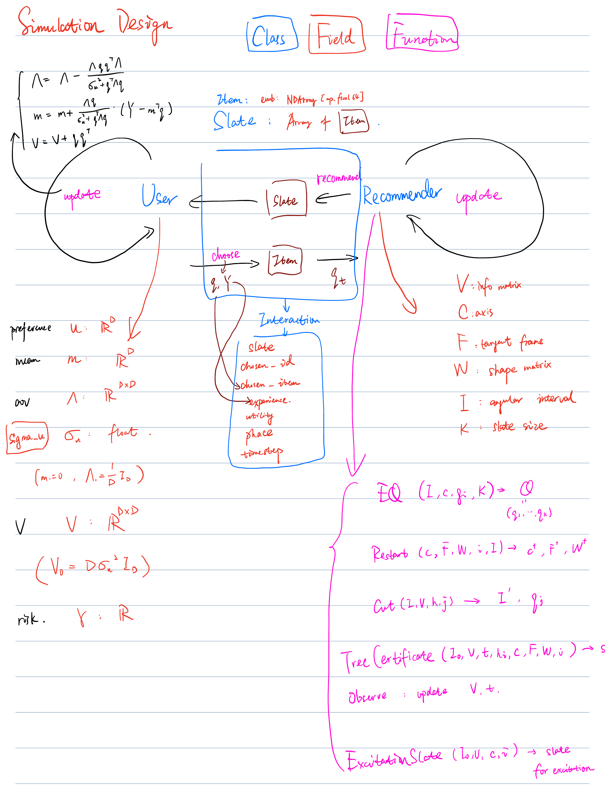

# K-RACER manual simulations

This repository contains the simulation code for the research project
*One Choice, Two Learners: Recommendation with Private User Learning*.

> **Original contributions, implementation, and AI assistance:** The author
> conceived K-RACER's core algorithmic ideas, designed the simulation
> architecture, and implemented the core K-RACER, user-learning, and
> recommender-user interaction code. Generative AI provided supporting
> assistance, primarily for plotting, baseline algorithm implementations, and
> ablation implementations. The author reviewed and checked the simulation
> code and outputs and takes responsibility for the final project.

## Project Development, Original Contributions, and AI Assistance

### Original Contributions and Implementation

The core algorithmic ideas behind **K-RACER**, including the longest-axis query
and cutting strategy, tree-based progress certificate, and integration of
ellipsoidal-cone geometry, were independently conceived and developed by the
author.

The overall simulation architecture was also designed by the author, including
the user-learning model, recommender-user interaction framework, and core
K-RACER implementation.

### Handwritten Research Notes and Design

The repository includes materials documenting the mathematical learning and
development process:

- [**Handwritten Mathematical Notes**](docs/math-model.pdf): Personal notes
  containing mathematical derivations, geometric explorations, and theoretical
  reasoning studied and developed during the project.
- [**Original Simulation Architecture**](docs/simulation-architecture.png):
  The author's handwritten design outlining the user, recommender, interaction
  structure, and key algorithmic components before and during implementation.

The architecture image is reproduced directly from the last handwritten page
of the original notes. The preceding mathematical notes are preserved in the
PDF. These author-created materials document the mathematical background and
design process for the simulation project.



### Generative AI Assistance

The central algorithmic ideas, overall simulation architecture, and core
K-RACER, user-learning, and interaction implementations originated from the
author.

**Generative AI tools were used to assist with the simulation code and project
development**, primarily for **plotting, implementing baseline algorithms,
and supporting ablation implementations**.

The author independently reviewed and checked the simulation code,
experiment outputs, and plots and **takes responsibility for the final
simulation project**.

## Saved Simulation Plots

The saved plots are included in this repository in **PNG, SVG, and PDF**:

- [All figure files](docs/plots/figures/)
- [Plot gallery](docs/plots/index.html) (open locally after cloning or downloading)
- [Figure metadata and SHA-256 checksums](docs/plots/manifest.json)

| Figure | Preview |
| --- | --- |
| 10: Baseline final regret distributions | [PNG](docs/plots/figures/current_reference.png) |
| 11: Baseline regret trajectories | [PNG](docs/plots/figures/current_reference_trajectories.png) |
| 12: Paired ablation regret distributions | [PNG](docs/plots/figures/current_report/03_paired_ablations.png) |
| 13: Regret versus slate size and noise | [PNG](docs/plots/figures/current_report/09_grid_K_effects.png) |

The gallery also includes Figures 16-24. GitHub displays the individual images;
to view the complete gallery, open it locally from this directory:

```powershell
Invoke-Item docs/plots/index.html
```

Only the rendered plots, gallery, and figure metadata are published. Raw
simulation data, CSV tables, and supplemental-data caches remain local.

## Running the Simulations

Run K-RACER, its three ablations, and four pairwise baselines, then plot the
saved results. All commands below run from this directory (`manual_simulations`).
Use one descriptive run name throughout, such as `reproduction` or
`baseline_t10000_seeds6000-6019`.

## Setup

Use Python 3.10 or newer. Install the simulation and plotting dependencies:

```powershell
python -m pip install -r plotting/requirements.txt
```

In Bash, use `python3` if that is your Python executable.

## Run and plot

Choose either the sequential or parallel workflow. Both use the same settings
and save native JSON that the plotter reads recursively.

### PowerShell: sequential

Set the run name once, run all methods, and plot that exact run:

```powershell
$RunName = 'reproduction'
$env:OPENBLAS_NUM_THREADS = '1'
$env:OMP_NUM_THREADS = '1'
$env:MKL_NUM_THREADS = '1'

python -B src/simulation_main.py --output "output/$RunName"
python -B -m plotting --input "output/$RunName" --output "plotting/results/$RunName"
Invoke-Item "plotting/results/$RunName/index.html"
```

### Git Bash, WSL, or Linux: parallel

The launcher starts one process per method, up to `JOBS` at a time. Each process
uses one BLAS thread. Set `PYTHON=python` instead if needed in Git Bash.

```bash
RUN_NAME=reproduction
RUN_NAME="$RUN_NAME" JOBS=4 PYTHON=python3 bash run_all.bash
python3 -B -m plotting --input "output/$RUN_NAME" --output "plotting/results/$RUN_NAME"
```

Open `plotting/results/reproduction/index.html` in a browser, substituting your
chosen run name. Parallel runs save JSON under `output/<run_name>/results/` and
per-method logs under `output/<run_name>/logs/`. Progress shows completed,
remaining, failed, and skipped evaluations. If a worker fails, the launcher
returns a failure status and retains partial results and logs.

Simulation output directories must be new: repeating a run name fails instead
of overwriting it. Choose another name for a fresh run. Without `RUN_NAME`, the
parallel launcher uses `manual_cases_<timestamp>`; the sequential runner also
uses a timestamp when `--output` is omitted. `OUTPUT_ROOT` changes the parallel
launcher's parent directory (default `output`).
Parallel run names must start with a letter or digit and may contain letters,
digits, dots, underscores, and hyphens.

### Plot an existing run

Skip simulation and point the plotter at the saved experiment you want to use:

```powershell
$RunName = 'reproduction'
python -B -m plotting --input "output/$RunName" --output "plotting/results/$RunName"
Invoke-Item "plotting/results/$RunName/index.html"
```

An existing directory can have any name; set `$RunName` to its name. The loader
supports sequential and parallel layouts, including older run directories.
Supply one experiment per invocation. Ordinary plotting reads `seed_*.json`
and `validation.json` without running simulations or changing the saved data.
Plot destinations must be inside `plotting/`, separate from source and input.
Replotting replaces generated files at that destination.

For reproducible plots, pass an explicit `--input`. Omitting it selects the
newest saved run under `output/`, which may change as you run more experiments.
Omitting `--output` writes to the shared `plotting/results/` gallery.

## Experiment settings and reproducibility

A run name identifies the results; random seeds and settings determine the
experiment. Keep the same source version, Python/dependency versions, options,
and seed ranges when reproducing a run. The defaults are:

| Setting | Default |
| --- | --- |
| Horizon | 10,000 rounds |
| Held-out test seeds | 6000-6019 (20 seeds) |
| Validation seeds | 120000-120003 (4 separate seeds) |
| T0 candidates | 0, 1, 2, 4, 8, 16, 32, 64, 128, 256, 512 |
| Contraction candidates | 0.8, 0.9, 0.95 |
| Analytical gate candidates | 32, 64, 128 |

Methods are `kracer`, `analytical_certificate`, `minimum_eigenvector`,
`without_restart`, `raes`, `dbgd`, `doubler`, and `sparring`. Use
`--algorithms` with the sequential runner to select a subset. K-RACER and its
ablations search post-startup T0 and a policy parameter; RAES searches absolute
T0. DBGD, Doubler, and Sparring use fixed settings and learn for the full horizon.
Selection uses validation seeds; held-out seeds evaluate the selected policy.

There are 14 scenarios. Noise means `sigma_u * sqrt(dimension)`:

| Scenario group | Dimension | K | Noise | Cases |
| --- | --- | --- | --- | --- |
| Baseline | 5 | 2 | 0.10 | 1 |
| Dimension changes | 3, 9 | 2 | 0.10 | 2 |
| User-learning speed changes | 5 | 2 | 0.05, 0.15 | 2 |
| Slate-size changes | 5 | 3, 5, 9 | 0.10 | 3 |
| Slate-size/noise combinations | 5 | 3, 5, 9 | 0.05, 0.15 | 6 |

K-RACER and its three ablations run on every scenario; the four baselines run
only on the five K=2 scenarios. The default experiment produces 1,520 held-out
test runs plus 7,612 logical validation evaluations. T0 search shares safe
exploration prefixes to reduce repeated work.

Parallel environment overrides are `RUN_NAME`, `OUTPUT_ROOT`, `JOBS`, `PYTHON`,
`HORIZON`, `SEED_COUNT`, `START_SEED`, `VALIDATION_SEED_COUNT`, and
`VALIDATION_START_SEED`. Other runner options pass through to each worker.
For a short pipeline check with all eight methods:

```bash
RUN_NAME=smoke_test JOBS=2 PYTHON=python3 HORIZON=12 SEED_COUNT=1 VALIDATION_SEED_COUNT=1 bash run_all.bash --cutoffs 0 2 --gamma-values 0.9 --gate-sizes 4
```

The equivalent sequential check in PowerShell is:

```powershell
python -B src/simulation_main.py --output output/smoke_test --horizon 12 --cutoffs 0 2 --gamma-values 0.9 --gate-sizes 4 --validation-seed-count 1 --seed-count 1
```

Run `python -B src/simulation_main.py --help` or
`python -B -m plotting --help` for the available Python CLI options.

## Plot outputs

Each plotting destination contains:

| Path | Contents |
| --- | --- |
| `index.html` | Figure gallery and CSV download links |
| `figures/` | PDF, SVG, and PNG plots |
| `data/selected_results.csv` | Regret means, confidence intervals, and selected settings |
| `data/baseline_boxplot_summary.csv` | Figure 10 distribution statistics |
| `data/paired_boxplot_summary.csv` | Figure 12 paired ablation-minus-K-RACER statistics |
| `data/paired_boxplot_samples.csv` | Individual paired differences with seed IDs |
| `data/figure_coverage.csv` | Available figures and missing-data limitations |
| `data/input_issues.csv` | Invalid or incomplete input groups |
| `manifest.json` | Input, source, and output hashes; plotting options and software versions |

The gallery puts Figures 10-13 first, then simulation-appendix Figures 16-24.
Figures 10 and 12 show means, medians, quartiles, 1.5-IQR whiskers, and every
test-seed sample. Figure 12 pairs samples by seed before computing differences;
positive differences favor K-RACER. Other means use marginal two-sided 95%
Student-t intervals; intervals are unavailable for a single seed.

The loader checks horizons, regret sums, phases, selected validation settings,
seed identities, and paired preferences. Incomplete groups are excluded by
default; `--include-incomplete` includes successful partial records with their
actual seed counts. Pairing requires matching seed sets. Trajectories retain
the first 128 epochs, every tenth later epoch, and the endpoint; add
`--trajectory-stride 1` to retain every epoch.

### Optional additional observations

The main runner saves held-out results only for selected budgets. Full test
budget curves, Startup-target sweeps, and supplied-cone runs need additional
simulations for Figures 18, 20, 22, and 24. After plotting the chosen run:

```powershell
$PlotDir = "plotting/results/$RunName"
python -B -m plotting.collect_additional --report "$PlotDir" --plan-only
python -B -m plotting.collect_additional --report "$PlotDir" --workers 4
python -B -m plotting.additional --report "$PlotDir"
```

The first command writes a plan; the second collects missing observations with
resumable, source-fingerprinted caches under `<plot_directory>/additional/`.
The third updates those four figures. The normal plotter also loads
`<plot_directory>/additional/supplement.json` when present; use
`--additional-data PATH` for another verified supplement. Missing observations
remain unavailable; validation scores are never substituted for held-out curves.

## Project layout and tests

```text
manual_simulations/
|-- README.md
|-- src/
|-- plotting/
|-- tests/
|-- run_all.bash
`-- docs/
    |-- math-model.pdf
    |-- simulation-architecture.png
    `-- plots/
```

- `docs/`: the author's handwritten mathematical notes, simulation design, and
  published plots under `docs/plots/`.
- `src/simulation_main.py`: cases, CLI, selection, and saved JSON.
- `src/simulation_state.py`: shared interaction loop and forkable state.
- `src/cutoff_search.py`: T0 evaluation and validation selection.
- `src/recommenders/`, `src/users/`: policies and the Bayesian-CARA user model.
- `plotting/`: saved-data loading, figures, CSV exports, and optional collection.
- `tests/`, `plotting/tests/`: simulation and plotting regression tests.
- `verification/`: historical comparison scripts and evidence.
- `output/`, `plotting/results/`: generated experiments and plots (Git-ignored).

Install pytest once, then run both test suites from this directory:

```powershell
python -m pip install pytest
python -B -m pytest -q
```
